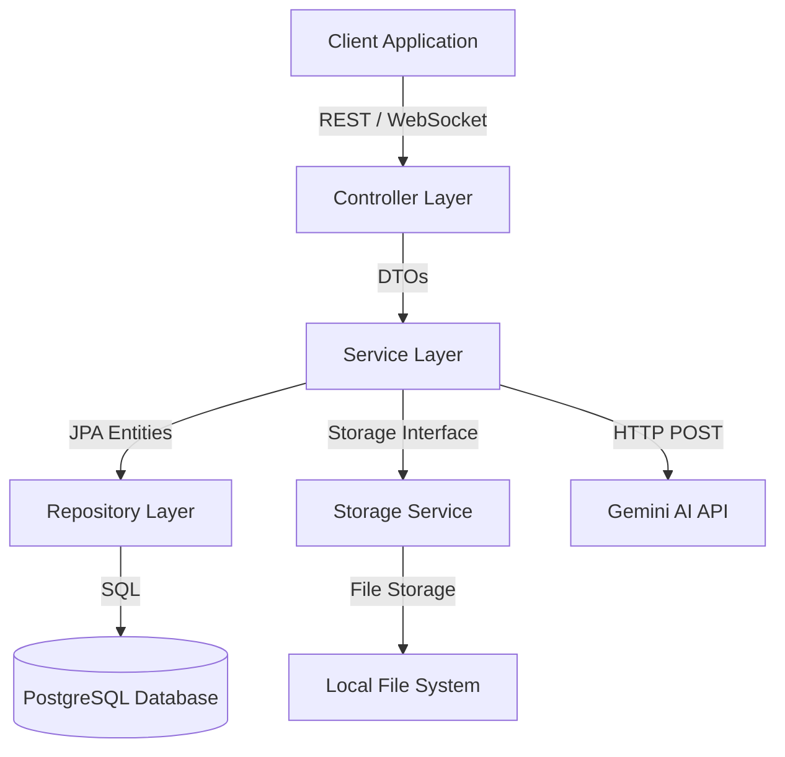
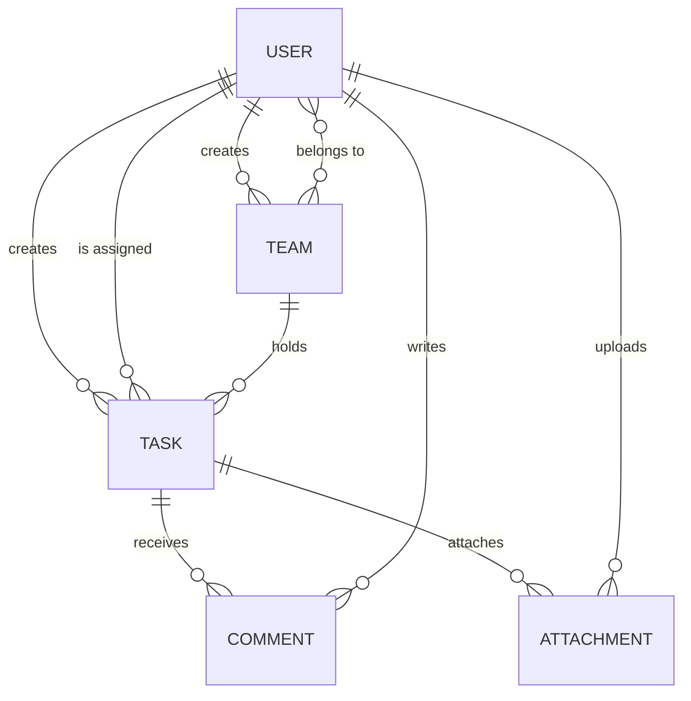

# TaskMaster: A Collaborative Task Tracking System

TaskMaster is a backend service designed for collaborative task tracking and team coordination. It provides APIs to manage tasks, create teams, assign work, collaborate via comments and file uploads, and receive real-time updates.

## System Architecture

TaskMaster is built using a clean layered architecture that decouples HTTP presentation, business rules, and database persistence.



### Design Choices

- **Layered Architecture**: Enforces unidirectional dependencies. The controllers communicate with services using Data Transfer Objects (DTOs), preventing internal database entity structures from leaking to API clients.
- **Stateless Authentication**: Uses Spring Security and JSON Web Tokens (JWT) for secure, stateless request authentication. This design eliminates session state on the server, making the API scalable.
- **Dynamic Queries**: Uses the JPA Specification pattern. This allows client requests to build complex search, filter, and sorting criteria dynamically without writing many custom SQL queries.
- **Resource Security**: Permissions are checked at the service boundary. Users can only read or modify tasks if they are the direct creator, the assignee, or members of the team associated with the task.
- **Storage Decoupling**: File operations are abstracted behind a `StorageService` interface. The implementation can be easily swapped from local file system storage to cloud block storage (such as AWS S3) in multi-node configurations.
- **Database Scalability**: The system uses PostgreSQL for persistence, supported by database-level indexes on foreign keys and filter columns (`tasks.assigned_to_id`, `tasks.team_id`, `tasks.status`) and HikariCP connection pooling for reliable transaction handling.

## Database Schema (ER Diagram)

The relational schema maps the relationships between users, teams, tasks, and collaboration resources.



## Features

- **User Access**: Register, login, retrieve profiles, and secure update profile endpoints.
- **Team Spaces**: Create teams and invite members. Tasks can be isolated to specific teams.
- **Task Management**: Fully supports task creation, retrieval, updates, and deletion. Filters tasks by status, team, assigned user, or search keywords. Supports sorting by due dates or update times.
- **Collaboration Tools**: Add text comments and upload files to any task. Attachments are saved via the decoupled storage service layer.
- **Real-Time Synchronisation**: Uses WebSockets with STOMP to broadcast updates. Users receive personal notifications when assigned a task, and task channels receive updates when comments or files are added.
- **AI-Assisted Writing**: Users can send a task title and context to generate a structured task description automatically.

## Technologies Used

- **Java 17**: Core language runtime.
- **Spring Boot 3.3.0**: Base framework for web services and dependency injection.
- **Spring Security**: Configuration for endpoint security and JWT parsing.
- **Spring Data JPA**: Database access layer powered by Hibernate.
- **PostgreSQL**: Robust relational database engine.
- **HikariCP**: High-performance JDBC connection pool.
- **Spring WebSocket**: Infrastructure for STOMP web socket communication.
- **JJWT 0.12.5**: Library to sign and verify JSON Web Tokens.
- **Lombok**: Annotation library to remove boilerplate getters and setters.

## Getting Started

### Requirements
- Java Development Kit (JDK) 17 or higher.
- Apache Maven (or use the provided Maven wrapper `mvnw`).
- A running PostgreSQL database instance.

### Execution Steps
1. Navigate to the project root directory.
2. Create a PostgreSQL database named `taskmasterdb`.
3. Open `src/main/resources/application.properties` and update the database credentials under the Database Configuration section:
   ```properties
   spring.datasource.url=jdbc:postgresql://localhost:5432/taskmasterdb
   spring.datasource.username=your_username
   spring.datasource.password=your_password
   ```
4. Build the project using Maven:
   ```bash
   mvn clean package
   ```
5. Run the application:
   ```bash
   mvn spring-boot:run
   ```
6. The server will start on port 8080.

### Environment Configuration
Adjust properties in `src/main/resources/application.properties` to configure settings:
- `app.upload.dir`: Directory where uploaded files are stored (default is `./uploads`).
- `app.gemini.api-key`: Set your Google Gemini API key to enable live AI task description generation.

## API Documentation

All request and response bodies use JSON format. Authenticated requests require the HTTP Header `Authorization: Bearer <your_jwt_token>`.

### Authentication endpoints
- `POST /api/auth/register`: Create a new user account.
  - Body: `{"username": "johndoe", "email": "john@example.com", "password": "password123"}`
- `POST /api/auth/login`: Log in to an account. Returns a JWT.
  - Body: `{"usernameOrEmail": "johndoe", "password": "password123"}`
  - Response: `{"accessToken": "eyJhb...", "tokenType": "Bearer"}`

### User Profile endpoints
- `GET /api/users/me`: View current user profile.
- `PUT /api/users/me`: Update profile details.
  - Body: `{"username": "john_new", "email": "john_new@example.com", "password": "newpassword123"}`

### Team endpoints
- `POST /api/teams`: Create a new team.
  - Body: `{"name": "Backend Team", "description": "Responsible for API development"}`
- `GET /api/teams`: List all teams the user belongs to.
- `POST /api/teams/{teamId}/members`: Add a user to the team.
  - Body: `{"emailOrUsername": "anotheruser"}`

### Task endpoints
- `POST /api/tasks`: Create a new task.
  - Body: `{"title": "Setup JWT", "description": "Configure spring security filters", "dueDate": "2026-08-10", "assignedToId": 2, "teamId": 1}`
- `GET /api/tasks`: Retrieve tasks. Use query parameters for filtering and sorting:
  - Query parameters: `keyword`, `status` (OPEN, IN_PROGRESS, COMPLETED), `teamId`, `assignedToId`, `sortBy`, `sortDir` (asc/desc).
- `GET /api/tasks/{taskId}`: Get full details of a task, including comments and attachments.
- `PUT /api/tasks/{taskId}`: Update task details.
- `DELETE /api/tasks/{taskId}`: Delete a task (creator only).

### Collaboration endpoints
- `POST /api/tasks/{taskId}/comments`: Add a text comment.
  - Body: `{"content": "I am working on this now."}`
- `POST /api/tasks/{taskId}/attachments`: Upload a file.
  - Body (Multipart Form-Data): `file` (binary payload)
- `GET /api/tasks/attachments/download/{attachmentId}`: Stream and download files.

### AI Suggestion endpoint
- `POST /api/tasks/ai/suggest`: Generate task description.
  - Body: `{"title": "Write unit tests", "context": "Focus on AuthController methods"}`
  - Response: `{"description": "Suggested subtasks and objectives..."}`

## Testing and Exception Handling

The system is equipped with validation controls and verification checks:

### Testing Suite
We have implemented controller-level tests with mocked service dependencies inside `src/test/java/com/taskmaster/controller/` using JUnit 5 and MockMvc:
- `AuthControllerTest`: Validates successful user registration, JWT generation, and username/email collision checks.
- `UserControllerTest`: Validates profile display and update parameter checks.
- `TeamControllerTest`: Checks team creation and team membership lookup rules (preventing duplicate memberships).
- `TaskControllerTest`: Verifies the task lifecycle, filters, comments, and attachments.
- `AiControllerTest`: Validates the generative description output and mock templates.

Run the test suite using:
```bash
mvn test
```

### Exception and Edge Case Security
- **Access Control (HTTP 403 Forbidden)**: Task manipulation (read, update, delete) enforces strict security bounds. Accessing a task that belongs to another team or attempting to delete a task you did not create throws an `AccessDeniedException`, which maps to an HTTP 403 Forbidden JSON payload.
- **Empty File Protection (HTTP 400 Bad Request)**: The storage engine checks file uploads, blocking empty files.
- **Collision Protection (HTTP 400 Bad Request)**: Block duplicate team member invitations and duplicate user account registrations.

## WebSocket Destinations

To configure real-time synchronization, connect to WebSocket endpoint `/ws` and subscribe to:
- `/user/queue/notifications`: Receives personal notifications (e.g. task assignment notifications).
- `/topic/tasks/{taskId}`: Receives updates when the task is edited, commented on, or has files added.
